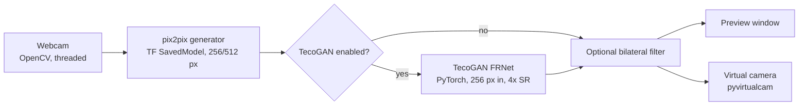

# pix2pix + TecoGAN: real-time webcam enhancement

Real-time webcam pipeline that cleans each frame with a pix2pix generator (TensorFlow), optionally upscales it with TecoGAN video super-resolution (PyTorch), and streams the result to a virtual camera so any video-call or capture app can use it.

<!-- TODO: demo GIF (side-by-side raw webcam vs. pipeline output) -->

## Highlights

- Two GAN models from different frameworks (TensorFlow SavedModel + PyTorch) chained in one capture loop.
- Threaded webcam capture (`WebcamVideoStream`) so frame grabbing does not block inference.
- Output to a preview window and/or a virtual camera via `pyvirtualcam`.
- Each stage can be switched on/off from `config/conf.yaml` (pix2pix, TecoGAN, bilateral denoise, preview, virtual cam).
- Conversion scripts: pix2pix checkpoint to SavedModel, and SavedModel to TF-TRT.
- pix2pix training notebooks (256x256 and 512x512) for the denoising model.

## How it works



The main loop is `live()` in [`pix2pix_tecogan_out.py`](pix2pix_tecogan_out.py). Each frame is resized to `pix2pix_size`, scaled to [-1, 1] and passed through the pix2pix generator. If `check_tecogan` is on, the result is resized to `tecogan_size` and passed through TecoGAN's frame-recurrent generator (`model.infer_live`). The frame is then optionally bilateral-filtered, shown, and sent to the virtual camera.

## Tech stack

Python, TensorFlow (pix2pix, TF-TRT), PyTorch (TecoGAN), OpenCV, pyvirtualcam, PyYAML, imutils. Pinned versions are from 2021 (`requirements.txt`, `requirements-gpu.txt`).

## Getting started

Prerequisites: an NVIDIA GPU with CUDA for TensorFlow and PyTorch, a webcam, and a virtual-camera backend that `pyvirtualcam` supports (v4l2loopback on Linux, OBS Virtual Camera on Windows/macOS). The loop was developed on Windows; see Limitations.

```bash
git clone https://github.com/bigalex95/pix2pix_TecoGAN
cd pix2pix_TecoGAN
python -m venv venv && source venv/bin/activate      # Windows: venv\Scripts\activate
pip install -r requirements.txt                      # pinned 2021 environment
```

### Models (not included in this repo)

No pretrained weights are committed. You need two things:

1. **pix2pix SavedModel**: train it with [`pix2pix/pix2pix256x256.ipynb`](pix2pix/pix2pix256x256.ipynb) or [`pix2pix/pix2pix512x512.ipynb`](pix2pix/pix2pix512x512.ipynb) on your own noisy/clean pairs, then export the checkpoint:
   ```bash
   cd TF_to_TF-TRT
   python checkpoint2saved_model.py --size 512 --input ./training_checkpoints --output ../model/pix2pixTF512
   # optional, needs TensorRT: edit paths in TF-TRT.py, then
   python TF-TRT.py
   ```
   The runtime loads `pix2pix_model_path + pix2pix_size`, i.e. `./model/pix2pixTF512` with the default config.
2. **TecoGAN weights** (only needed when `check_tecogan: 1`): use the upstream download script from the repo root,
   ```bash
   cd TecoGAN_PyTorch && bash scripts/download/download_models.sh BD TecoGAN && cd ..
   ```
   which fetches `TecoGAN_PyTorch/pretrained_models/TecoGAN_BD_iter500000.pth` (the path referenced by `config/live.yml`).

### Run

Edit [`config/conf.yaml`](config/conf.yaml) (camera index, model paths and sizes, stage switches), then from the repo root:

```bash
python pix2pix_tecogan_out.py
```

Press `q` in the preview window to quit and `w` to toggle the virtual camera. The script prints approximate FPS on exit. The same loop is available interactively in [`pix2pix_tecogan.ipynb`](pix2pix_tecogan.ipynb).

Config keys that matter: `pix2pix_size` (256 or 512), `tecogan_size`, `check_pix2pix`, `check_tecogan`, `check_denoise`, `check_display`, `check_webcam`, `camera_src`, `pix2pix_gpu`, `tecogan_gpu`. TecoGAN settings are read from `<tecogan_conf_path>/live.yml`; a copy of the upstream `live.yml` is in `config/`.

## Notebooks

| Notebook | Purpose |
| --- | --- |
| `pix2pix/pix2pix256x256.ipynb`, `pix2pix/pix2pix512x512.ipynb` | pix2pix training (adapted from the TensorFlow pix2pix tutorial) at two resolutions |
| `pix2pix_tecogan.ipynb` | notebook version of the live pipeline |
| `experiments/pix2pix_tecogan2.ipynb`, `experiments/denoising.ipynb` | scratch experiments, including classical denoising comparisons |

## Project structure

```
pix2pix_TecoGAN/
  pix2pix_tecogan_out.py   # live pipeline entry point (own code)
  pix2pix_tecogan.ipynb    # notebook version of the pipeline
  config/                  # conf.yaml (pipeline), live.yml (TecoGAN live settings)
  pix2pix/                 # pix2pix training notebooks
  TF_to_TF-TRT/            # checkpoint -> SavedModel -> TF-TRT scripts
  experiments/             # scratch scripts and notebooks
  TecoGAN_PyTorch/         # vendored upstream code (Apache-2.0), see Credits
  requirements*.txt
```

Own code: everything except `TecoGAN_PyTorch/` (third-party code; it contains a `live` mode and `infer_live` that this pipeline uses, which may be local additions to upstream).

## Status and limitations

- Prototype from 2021; no tests, no CI, no pretrained weights, and no measured latency/FPS or quality metrics are included. Results depend entirely on the pix2pix model you train.
- pix2pix acts as a learned denoiser/translator at 256 or 512 px; TecoGAN is the only super-resolution stage and is off by default (`check_tecogan: 0`).
- Windows-oriented: webcam capture uses `cv2.CAP_DSHOW`. On Linux/macOS change `cv2.VideoCapture` calls in `pix2pix_tecogan_out.py`.
- With TecoGAN enabled, the script is hard-coded to CUDA device 1 (`cuda:1`, `.cuda(1)`); change these on single-GPU machines.
- The pix2pix generator is called with `training=True` (dropout/batch-norm active), as in the TensorFlow tutorial's preview code.
- Dependency pins are old (TensorFlow 2.4 era) and may not install on current Python versions.

## Credits

- **pix2pix**: Isola, Zhu, Zhou, Efros, "Image-to-Image Translation with Conditional Adversarial Networks" (CVPR 2017). The training notebooks are adapted from the TensorFlow pix2pix tutorial (Apache-2.0).
- **TecoGAN**: Chu, Xie, Mayer, Leal-Taixe, Thuerey, "Learning Temporal Coherence via Self-Supervision for GAN-based Video Generation" (SIGGRAPH 2020), official implementation [thunil/TecoGAN](https://github.com/thunil/TecoGAN).
- **TecoGAN_PyTorch/** is a vendored copy of [skycrapers/TecoGAN-PyTorch](https://github.com/skycrapers/TecoGAN-PyTorch), a PyTorch reimplementation of TecoGAN, licensed under Apache-2.0 (see [`TecoGAN_PyTorch/LICENSE`](TecoGAN_PyTorch/LICENSE) and its own README). It includes LPIPS code and weights under their own license. The GIFs under `TecoGAN_PyTorch/resources/` are upstream's demo of TecoGAN, not output of this pipeline.

## License

Own code: MIT, see [LICENSE](LICENSE). Vendored `TecoGAN_PyTorch/` remains under Apache-2.0.
